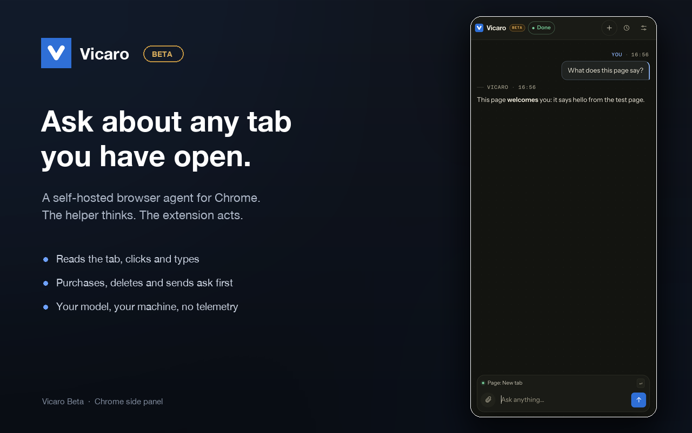

# Vicaro Beta

**A self-hosted browser assistant for Chrome.** Vicaro lives in the side panel, reads
the tabs you already have open, clicks and types when you ask it to, and offers
five autonomy modes that control when it must ask first. Models run on your machine,
your LAN, or an endpoint you choose.

[Website](https://vicaro.creativeducks.com) · [Add to Chrome](https://chromewebstore.google.com/detail/vicaro-beta/inemnoeadlodgmheeijooeknmladelok) · [Support](https://vicaro.creativeducks.com/support.html) · [Privacy](https://vicaro.creativeducks.com/privacy.html)



> **Beta software.** Vicaro can click, type, submit forms, make purchases, delete data,
> and change account settings. Actions you approve can lead to loss of money, data,
> access, or account state. Keep backups, use a Chrome profile you can afford to lose,
> and start with **Read only** or **Ask first**.

## What it does

- **Works in the browser you already use.** It sees open tabs, page content and the
  interactive elements on the current page, with the logins already in Chrome.
- **Acts, then checks.** It clicks, types, scrolls and navigates, then verifies the page
  before answering.
- **Approval modes control damage.** In Ask first and Light touch, purchases,
  deletes, sends and uploads stop for approval. Full auto and Super can run scoped
  writes without a prompt.
- **Uses your model.** Point the helper at Ollama, LM Studio, mlx, vLLM, or any
  OpenAI-compatible endpoint. There is no default provider and no fallback.
- **Keeps data local.** No analytics, telemetry, or sale of data. Chat, tasks and
  memories are stored locally by the helper.
- **Sign in once, auto-connect.** Sign in with Google or a passwordless email magic
  link (via Firebase Authentication) so your browsers, local web workspace, and
  devices connect automatically without pairing codes. No chats or pages are sent
  to Google or Firebase.
- **Automatic helper updates.** From 1.5.0 onward, `Vicaro Helper.app` checks GitHub
  Releases automatically, verifies SHA-256 checksums, and updates itself in place —
  with a menu bar toggle to pause or resume auto-updates anytime.

The beta is panel-first. Helper 1.5+ also ships `vicaro-mcp`, an MCP server that
exposes Vicaro's browser tools to other apps: open the web console, go to
**Connections**, and under **MCP hosts** install Vicaro into Cursor, Claude Code,
Claude Desktop, Codex, VS Code, Windsurf, Grok Build or opencode. The helper can
also consume MCP servers you configure.

## Requirements

| | |
|---|---|
| OS | macOS 13.5+, Linux (x86_64 / arm64), or Windows 10/11 (x86_64 / arm64) |
| Browser | Chrome 116 or newer |
| Hardware | Apple Silicon, Intel, or x86_64 / arm64 |
| Model | A local OpenAI-compatible server, or a hosted endpoint with an API key |

The extension is live on the Chrome Web Store.

## Get started

### 1. Add the extension

Install **[Vicaro Beta](https://chromewebstore.google.com/detail/vicaro-beta/inemnoeadlodgmheeijooeknmladelok)**
from the Chrome Web Store. Its setup tab opens automatically and shows the Terminal
command below (and prompts you to run it if an older pre-1.5.0 helper is detected).

The store can trail the latest release while a new version is in review. For the
newest extension, download
[`Vicaro-extension.zip`](https://github.com/sandeshwar/vicaro-public/releases/latest/download/Vicaro-extension.zip)
from the [latest GitHub release](https://github.com/sandeshwar/vicaro-public/releases/latest),
unzip it, open `chrome://extensions`, turn on Developer mode and click
**Load unpacked**, then sign in in the new extension. Unpacked builds do not update
themselves, so download the zip again for each release; use either the store version
or the zip, not both.

### 2. Install the helper

**macOS & Linux** — open Terminal and run:

```sh
curl -fsSL https://vicaro.creativeducks.com/install.sh | sh
```

**Windows** — open PowerShell (`Win+X` → Terminal / Windows PowerShell) and run:

```powershell
irm https://vicaro.creativeducks.com/install.ps1 | iex
```

The installer downloads the latest release tarball, verifies its SHA-256, installs
`Vicaro Helper.app` into `~/Applications`, registers the login agent, and starts the
helper on `ws://127.0.0.1:8792/chrome`. It asks for no password and does not use
`sudo`. It does not modify the extension.

The supported path uses no disk image. While the helper is ad-hoc signed and not
notarized, a browser download would trigger macOS Gatekeeper; `curl` does not set the
quarantine flag. The setup tab watches for the helper and prompts you to sign in as
soon as it starts.

### 3. Sign in to connect

Sign in with Google or an email magic link in the setup tab (or choose **Sign in to
Vicaro…** in the helper menu bar app). If you sign in from Chrome first, click **Allow**
on the one-time confirmation dialog on your Mac. Any additional browser or device
signed into the same account connects automatically with no pairing code.

### 4. Pick a model

Open **Settings, Model** and enter the base URL and model id for your endpoint. Use
**Fetch models** to check the connection. For Ollama the common base is
`http://127.0.0.1:11434`. A model on another machine on your LAN works too, for
example `http://192.168.1.40:11434/v1`; start Ollama there with
`OLLAMA_HOST=0.0.0.0:11434`. Plain HTTP is allowed for loopback and private
addresses, while public hosts must use HTTPS.

Local models can take a while to prefill a large prompt or a screenshot-heavy
context before they stream anything. The helper gives local endpoints up to five
minutes of silence before it reports a timeout. If a turn times out, wait for the
model server to go idle and press Retry; the prompt is usually cached by then.

### 5. Ask

Try a read-only request first: "summarize this page" or "what changed in my other
tabs?". Then move to actions when you are comfortable with the approval mode.

Long tasks do not have a fixed message or step limit. When the turn approaches
the model window, Vicaro folds older work into a written handoff that preserves
the goal, constraints, current page state, evidence and open steps. Recent
messages stay exact, the full transcript remains in the encrypted local store,
and the compacted checkpoint survives a helper restart.

## What gets installed

**macOS:**

| Path | What |
|---|---|
| `~/Applications/Vicaro Helper.app` | Menu bar helper, Rust, ad-hoc signed |
| `~/Library/Application Support/Vicaro/helper` | Local data, history and encrypted stores |
| `~/Library/LaunchAgents/com.vicaro.helper.app.plist` | Login agent |
| `~/Library/Logs/Vicaro/helper.log` | Helper log |

**Linux:**

| Path | What |
|---|---|
| `~/.local/share/vicaro/app` | Helper binaries (`vicaro-helper`, `vicaro-mcp`), runtime wrapper, and tray/CLI controller |
| `~/.local/bin/vicaro-helper` | CLI (`status`, `start`, `stop`, `open-ui`, `sign-in`, `approve`, `update`, `uninstall`) |
| `~/.local/share/vicaro/helper` | Local data, history and encrypted stores |
| `~/.config/systemd/user/vicaro-helper.service` | User login service |
| `~/.config/autostart/vicaro-helper-tray.desktop` | Tray / desktop notification & claim-prompt agent |
| `~/.local/share/applications/vicaro-helper.desktop` | `vicaro://` deep-link handler |
| `~/.local/state/vicaro/helper.log` | Helper log |

**Windows:**

| Path | What |
|---|---|
| `%LOCALAPPDATA%\Vicaro\app` | Helper binaries (`vicaro-helper.exe`, `vicaro-mcp.exe`), tray app, and CLI |
| `%LOCALAPPDATA%\Vicaro\bin\vicaro-helper.cmd` | CLI shim (added to user `PATH`) |
| `%LOCALAPPDATA%\Vicaro\helper` | Local data, history and encrypted stores |
| `HKCU\Software\Microsoft\Windows\CurrentVersion\Run\VicaroHelper` | Login startup entry |
| `HKCU\Software\Classes\vicaro` | `vicaro://` deep-link handler |
| `%LOCALAPPDATA%\Vicaro\Logs\helper.log` | Helper log |

The macOS installer removes the retired TypeScript `Vicaro Orchestrator.app` and its login
agent when it upgrades an older install.

### Uninstall

On macOS, use **Uninstall Vicaro Helper** in the menu bar. On Linux or Windows, use
**Uninstall** from the tray menu or run `vicaro-helper uninstall`. All remove the app
and its login service while keeping chats, memories, settings, model configuration and
the account link in `~/Library/Application Support/Vicaro` (macOS),
`~/.local/share/vicaro/helper` (Linux), or `%LOCALAPPDATA%\Vicaro\helper` (Windows).
Reinstalling finds them intact. Remove the extension separately from `chrome://extensions`
if you want it gone too.

From a terminal, the equivalent is:

```sh
launchctl bootout "gui/$(id -u)/com.vicaro.helper.app" 2>/dev/null
rm -rf "$HOME/Applications/Vicaro Helper.app" "$HOME/Library/LaunchAgents/com.vicaro.helper.app.plist"
```

## Safety and privacy

Vicaro is early beta software with real browser access. Read the
[beta safety notes](https://vicaro.creativeducks.com/support.html#safety) and the
[privacy policy](https://vicaro.creativeducks.com/privacy.html) before approving
actions.

- Page access is granted per site.
- Approval is mode-dependent: Ask first and Light touch stop for writes; Full auto
  and Super can run scoped writes without a prompt.
- Deep control is attached only while a task needs it.
- The model endpoint you configure is the only remote service that sees page content.

## Troubleshooting

| Symptom | Try |
|---|---|
| Panel cannot reach the helper | Check the menu bar globe, confirm `ws://127.0.0.1:8792/chrome`, press **Save & reconnect**. |
| Email magic link opened in Safari | Confirm your email if prompted — the helper completes sign-in locally and Chrome connects automatically. |
| Console: `WebSocket ... HTTP Authentication failed` | The helper is refusing an unauthenticated browser. Sign in from the side panel or setup tab; the message stops once connected. |
| Model errors | Check the base URL, `/v1` suffix and API key in **Settings, Model**. |
| Page access is missing | Grant the site when prompted, or check **Settings, Access**. |
| "Apple could not verify Vicaro Helper" | You used an older disk image. Delete it and run the install command above. |
| "Vicaro Helper is damaged" | Re-run the install command. Your chats and settings are kept. |

More detail is in [Support](https://vicaro.creativeducks.com/support.html). The helper
log is at `~/Library/Logs/Vicaro/helper.log`.

## Report a bug or request a feature

Use [GitHub Issues](https://github.com/sandeshwar/vicaro-public/issues/new/choose).
Please include:

- macOS version and Chrome version.
- Helper version and extension version from `chrome://extensions`.
- What you expected, what happened, and the steps to reproduce it.
- The panel message and the last relevant lines from `~/Library/Logs/Vicaro/helper.log`.

Remove page content, tokens, API keys, account names, and anything else personal
before posting. Do not open a public issue for a security problem. Email
[hello@creativeducks.com](mailto:hello@creativeducks.com) instead. See
[SECURITY.md](SECURITY.md) for the private reporting process.

Feature requests are welcome in the same tracker. State the task you are trying to
finish, not only the control you want.

## What is in this repository

This is the public site and release repository, not the application source. Vicaro is
proprietary software and the helper source stays private.

| Path | What |
|---|---|
| `/` | Landing page (`index.html`) |
| `/auth/` | Hosted Google & email magic link sign-in page (`auth/index.html`) |
| `/support.html` | Support and troubleshooting |
| `/privacy.html` | Privacy policy |
| `/install.sh` | macOS & Linux installer |
| `/install.ps1` | Windows PowerShell installer |
| `/assets/shots/` | Screenshots used by the site and store listing |
| `/llms.txt` | Concise product facts and canonical links for AI crawlers |
| `/site.css`, `/site.js` | Shared page styles and small enhancements |

Builds are not stored in git. The tarballs, checksums and development extension
zip live on [GitHub Releases](https://github.com/sandeshwar/vicaro-public/releases).

## For maintainers

### Deploy the site

GitHub Pages builds this repository on every push to `main`. The custom domain is
`vicaro.creativeducks.com`; `CNAME` holds the name and `install.sh` is served from
the same root.

### Preview locally

```sh
python3 -m http.server 8088
# open http://127.0.0.1:8088/
```

There is no build step. `site.js` is optional: the copy button falls back to selecting
the command, and the mobile menu is a native `<details>` element.

### Publish a release

1. In the private app repo, run
   `VICARO_RELEASE_CHANNEL=store ./deploy/rust/release.sh`. It builds the Rust helper
   for arm64 and x86_64, configures both the development and store extension IDs,
   bundles the pinned development extension, signs the apps ad-hoc, and writes the
   tarballs, checksums and `Vicaro-extension.zip` to `dist/release/`. The Chrome Web
   Store package is built separately with `npm run pack:extension`.
2. Create a GitHub Release tagged `v<version>` with all assets:
   `Vicaro-macos-arm64.tar.gz`, `Vicaro-macos-x86_64.tar.gz`, both `.sha256`
   files, and `Vicaro-extension.zip`. Do not publish a disk image while the helper
   is ad-hoc signed; `install.sh` is the supported path.

   Transition note: the `v1.4.12` release keeps its legacy `Vicaro-Helper.dmg`
   asset for users still upgrading from older 1.4.7 store installs. Starting with
   `v1.5.0`, the extension uses `install.sh` directly and detects older helpers,
   and `Vicaro Helper.app` handles future updates automatically from the tarball
   assets.
3. Update `install.sh` here if the app name, launch agent or paths changed.
4. Verify:

   ```sh
   curl -fsSL https://vicaro.creativeducks.com/install.sh | sh -s -- --dry-run
   ```

### Web UI bundle rules

The helper currently ships its UI embedded. A signed `/webui/<version>/` bundle
is a deferred design, not an implemented distribution path; do not publish one as
if the helper can load it today.

If that design is implemented later, the intended rules are:

- **Version-pinned directories, immutable.** Never edit a published version.
- **The manifest lists every file with its SHA-256**, plus a signature over the
  manifest. The helper verifies both and falls back to the embedded copy.
- **No remote code.** The bundle is HTML, CSS and JS served by the helper, with the
  same loopback API and token as the embedded copy.

## License

Vicaro is proprietary software. This repository contains the public site and release
packaging, not the application source. All rights reserved. No license is granted for
the Vicaro name, logo, binaries, or application source.
