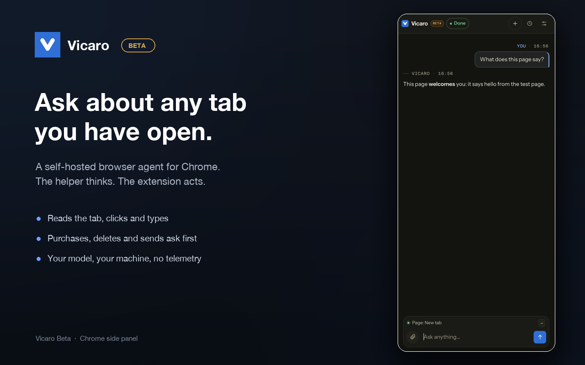

# Vicaro Beta

**A self-hosted browser assistant for Chrome.** Vicaro lives in the side panel, reads
the tabs you already have open, clicks and types when you ask it to, and asks before
anything destructive. Models run on your machine, your LAN, or an endpoint you choose.

[Website](https://vicaro.creativeducks.com) · [Download](https://github.com/sandeshwar/vicaro-public/releases/latest) · [Support](https://vicaro.creativeducks.com/support.html) · [Privacy](https://vicaro.creativeducks.com/privacy.html)



> **Beta software.** Vicaro can click, type, submit forms, make purchases, delete data,
> and change account settings. Actions you approve can lead to loss of money, data,
> access, or account state. Keep backups, use a Chrome profile you can afford to lose,
> and start with **Read only** or **Ask first**.

## What it does

- **Works in the browser you already use.** It sees open tabs, page content and the
  interactive elements on the current page, with the logins already in Chrome.
- **Acts, then checks.** It clicks, types, scrolls and navigates, then verifies the page
  before answering.
- **Asks before damage.** Purchases, deletes, sends and uploads stop for approval.
- **Uses your model.** Point the helper at Ollama, LM Studio, mlx, vLLM, or any
  OpenAI-compatible endpoint. There is no default provider and no fallback.
- **Keeps data local.** No Vicaro account is required. No analytics, telemetry, or sale
  of data. Chat, tasks and memories are stored locally by the helper.
- **Optional Google sign-in.** One account can be linked for the web UI. No chats or
  pages are sent to Google or Firebase.

The beta is panel-first. MCP host support for tools such as Cursor, Claude Code and
Codex is still being brought over from the reference app. The current helper can
consume MCP servers you configure, but it does not register itself in those tools
yet. The panel labels that settings card accordingly.

## Requirements

| | |
|---|---|
| OS | macOS 13.5 or newer |
| Browser | Chrome 116 or newer |
| Hardware | Apple Silicon or Intel |
| Model | A local OpenAI-compatible server, or a hosted endpoint with an API key |

Linux packaging is in progress. Windows is not supported yet. The Chrome Web Store
listing is in preparation, so the extension is loaded unpacked for now.

## Get started

### 1. Install the helper

```sh
curl -fsSL https://vicaro.creativeducks.com/install.sh | sh
```

The installer downloads the latest release, verifies its SHA-256, installs
`Vicaro Helper.app` into `~/Applications`, stages the extension, registers the login
agent, and starts the helper on `ws://127.0.0.1:8792/chrome`.

Prefer a disk image? Download the universal DMG from the
[latest release](https://github.com/sandeshwar/vicaro-public/releases/latest), open it,
and drag **Vicaro Helper** to Applications. The same image runs on Apple Silicon and
Intel.

### 2. Load the extension

1. Open `chrome://extensions`.
2. Turn on **Developer mode**.
3. Choose **Load unpacked**.
4. Press Cmd+Shift+G, paste the folder path the installer copied, then Return.

The folder is `~/Library/Application Support/Vicaro/extension`. If you used the DMG,
download `Vicaro-extension.zip` from the release, unzip it, and load that folder.

### 3. Pair the panel

Click the Vicaro Beta icon to open the side panel. The first run asks the helper to
pair this browser. Approve **Chrome on macOS** in the helper menu, or copy the pairing
code from the menu and paste it into the panel.

### 4. Pick a model

Open **Settings, Model** and enter the base URL and model id for your endpoint. Use
**Fetch models** to check the connection. For Ollama the common base is
`http://127.0.0.1:11434`. A model on another machine on your LAN works too, for
example `http://192.168.1.40:11434/v1`; start Ollama there with
`OLLAMA_HOST=0.0.0.0:11434`. Plain HTTP is allowed for loopback and private
addresses, while public hosts must use HTTPS.

Local models can take a while to prefill a large prompt or a screenshot-heavy
context before they stream anything. The helper gives local endpoints up to five
minutes of silence before it reports a timeout. If a turn times out, wait for the
model server to go idle and press Retry; the prompt is usually cached by then.

### 5. Ask

Try a read-only request first: "summarize this page" or "what changed in my other
tabs?". Then move to actions when you are comfortable with the approval mode.

## What gets installed

| Path | What |
|---|---|
| `~/Applications/Vicaro Helper.app` | Menu bar helper, Rust, ad-hoc signed |
| `~/Library/Application Support/Vicaro/extension` | Unpacked Chrome extension |
| `~/Library/Application Support/Vicaro/helper` | Local data, history and encrypted stores |
| `~/Library/LaunchAgents/com.vicaro.helper.app.plist` | Login agent |
| `~/Library/Logs/Vicaro/helper.log` | Helper log |

The installer removes the retired TypeScript `Vicaro Orchestrator.app` and its login
agent when it upgrades an older install.

### Uninstall

Use **Uninstall Vicaro Helper** in the menu bar. It removes the app and its login
item, but keeps chats, memories, settings, model configuration, the account link
and the staged extension in `~/Library/Application Support/Vicaro`. Reinstalling
finds them intact. Remove the extension separately from `chrome://extensions` if
you want it gone too.

From a terminal, the equivalent is:

```sh
launchctl bootout "gui/$(id -u)/com.vicaro.helper.app" 2>/dev/null
rm -rf "$HOME/Applications/Vicaro Helper.app" "$HOME/Library/LaunchAgents/com.vicaro.helper.app.plist"
```

## Safety and privacy

Vicaro is early beta software with real browser access. Read the
[beta safety notes](https://vicaro.creativeducks.com/support.html#safety) and the
[privacy policy](https://vicaro.creativeducks.com/privacy.html) before approving
actions.

- Page access is granted per site.
- Destructive actions always ask.
- Deep control is attached only while a task needs it.
- The model endpoint you configure is the only remote service that sees page content.

## Troubleshooting

| Symptom | Try |
|---|---|
| Panel cannot reach the helper | Check the menu bar globe, confirm `ws://127.0.0.1:8792/chrome`, press **Retry connection**. |
| Pairing request never appears | Use **Copy pairing code** in the helper menu and paste it into the panel. |
| Console: `WebSocket ... HTTP Authentication failed` | The helper is refusing an unpaired browser. Open the side panel and approve the request in the helper menu; the message stops after pairing. |
| Model errors | Check the base URL, `/v1` suffix and API key in **Settings, Model**. |
| Page access is missing | Grant the site when prompted, or check **Settings, Access**. |
| "Vicaro Helper is damaged" | `xattr -dr com.apple.quarantine ~/Applications/"Vicaro Helper.app"` |

More detail is in [Support](https://vicaro.creativeducks.com/support.html). The helper
log is at `~/Library/Logs/Vicaro/helper.log`.

## Report a bug or request a feature

Use [GitHub Issues](https://github.com/sandeshwar/vicaro-public/issues/new/choose).
Please include:

- macOS version and Chrome version.
- Helper version and extension version from `chrome://extensions`.
- What you expected, what happened, and the steps to reproduce it.
- The panel message and the last relevant lines from `~/Library/Logs/Vicaro/helper.log`.

Remove page content, tokens, API keys, account names, and anything else personal
before posting. Do not open a public issue for a security problem. Email
[hello@creativeducks.com](mailto:hello@creativeducks.com) instead. See
[SECURITY.md](SECURITY.md) for the private reporting process.

Feature requests are welcome in the same tracker. State the task you are trying to
finish, not only the control you want.

## What is in this repository

This is the public site and release repository, not the application source. Vicaro is
proprietary software and the helper source stays private.

| Path | What |
|---|---|
| `/` | Landing page (`index.html`) |
| `/support.html` | Support and troubleshooting |
| `/privacy.html` | Privacy policy |
| `/install.sh` | macOS installer |
| `/assets/shots/` | Screenshots used by the site and store listing |
| `/llms.txt` | Concise product facts and canonical links for AI crawlers |
| `/site.css`, `/site.js` | Shared page styles and small enhancements |
| `/webui/<version>/` | Optional signed helper web UI bundle |

Builds are not stored in git. The tarballs, checksums, DMG and extension zip live on
[GitHub Releases](https://github.com/sandeshwar/vicaro-public/releases).

## For maintainers

### Deploy the site

GitHub Pages builds this repository on every push to `main`. The custom domain is
`vicaro.creativeducks.com`; `CNAME` holds the name and `install.sh` is served from
the same root.

### Preview locally

```sh
python3 -m http.server 8088
# open http://127.0.0.1:8088/
```

There is no build step. `site.js` is optional: the copy button falls back to selecting
the command, and the mobile menu is a native `<details>` element.

### Publish a release

1. In the private app repo, run
   `VICARO_RELEASE_CHANNEL=store ./deploy/rust/release.sh`. It builds the Rust helper
   for arm64 and x86_64, configures both the development and store extension IDs,
   bundles the pinned development extension, signs the apps ad-hoc, and writes the
   tarballs, checksums, universal DMG and `Vicaro-extension.zip` to `dist/release/`.
   The Chrome Web Store package is built separately with `npm run pack:extension`.
2. Create a GitHub Release tagged `v<version>` with all assets:
   `Vicaro-macos-arm64.tar.gz`, `Vicaro-macos-x86_64.tar.gz`, both `.sha256`
   files, `Vicaro-Beta-<version>.dmg` with its checksum, and
   `Vicaro-extension.zip`.
3. Update `install.sh` here if the app name, launch agent or paths changed.
4. Verify:

   ```sh
   curl -fsSL https://vicaro.creativeducks.com/install.sh | sh -s -- --dry-run
   ```

### Web UI bundle rules

The helper ships its UI embedded, and can also load a signed bundle from
`/webui/<version>/`. That exists so UI changes can ship without a helper release.

- **Version-pinned directories, immutable.** Never edit a published version.
- **The manifest lists every file with its SHA-256**, plus a signature over the
  manifest. The helper verifies both and falls back to the embedded copy.
- **No remote code.** The bundle is HTML, CSS and JS served by the helper, with the
  same loopback API and token as the embedded copy.

## License

Vicaro is proprietary software. This repository contains the public site and release
packaging, not the application source. All rights reserved. No license is granted for
the Vicaro name, logo, binaries, or application source.
